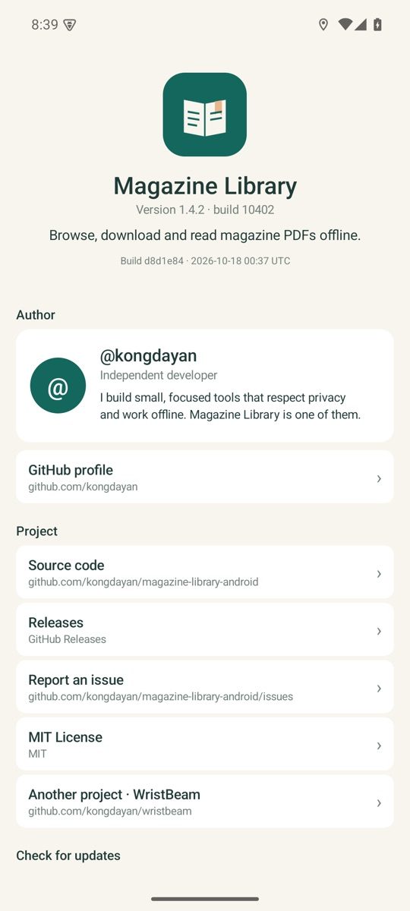

<div align="center">


# Magazine Library

杂志以 PDF 的形式到达，手机应该让你离线读完它。

[](https://github.com/kongdayan/magazine-library-android/actions/workflows/ci.yml)
[](https://github.com/kongdayan/magazine-library-android/releases/latest)
[](LICENSE)
[](https://github.com/kongdayan/magazine-library-android/releases/latest)
[](docs/ARCHITECTURE.md#localization)

[English](README.md) · [简体中文](README.cn.md) · [日本語](README.ja.md) · [한국어](README.ko.md) · [Русский](README.ru.md)

</div>

**一个小巧、纯本地的 Android 客户端：浏览杂志网站、下载 PDF、离线阅读。**

我只是想在通勤路上读完一期杂志，却要在浏览器标签页、下载文件夹和另一个 PDF 阅读器之间来回切换。于是有了 Magazine Library：网站会话保留在 WebView 里，你请求的那一页被转换成原生控件，下载在后台完成，最后在带进度记忆的阅读器里打开。没有账号、没有广告、没有统计、没有云服务。

- **发现页去掉了网页的干扰。** 搜索、分类、发布月份、封面、详情、同系列、本页排序和翻页，全部用原生界面展示。只有你打开的那一页才会被请求。
- **下载不再被网站卡住。** 下载器按域名沿用浏览器会话，跟随网站的文件准备步骤，服务器支持时断点续传，校验 PDF 通过后才保存到 Download 或你选择的文件夹。
- **是书库，不只是文件夹。** 封面、网格或列表、按刊名分组、重命名、排序和阅读进度。文件仍然放在你指定的位置。
- **认真读。** 单页横滑或连续滚动、双指缩放、页码跳转，退出后回到上次阅读的位置。
- **五种语言，一个小 APK。** 英文、简体中文、日语、韩语、俄语，可在设置或 Android 的按应用语言中切换。不使用 AndroidX，没有第三方运行时库，没有广告。

<div align="center">
  
  
  
  <br />
  
  
</div>

截图来自 1.4 版本的 Android 15 模拟器验证。界面支持英文、简体中文、日语、韩语和俄语，详见[验证范围](docs/VERIFICATION.md)。

## 安装

需要 Android 10（API 29）或更高版本。

| 设备 | 下载 |
| --- | --- |
| 任意受支持设备（**推荐**） | [MagazineLibrary-universal.apk](https://github.com/kongdayan/magazine-library-android/releases/latest/download/MagazineLibrary-universal.apk) |
| arm64-v8a | [MagazineLibrary-arm64-v8a.apk](https://github.com/kongdayan/magazine-library-android/releases/latest/download/MagazineLibrary-arm64-v8a.apk) |
| armeabi-v7a | [MagazineLibrary-armeabi-v7a.apk](https://github.com/kongdayan/magazine-library-android/releases/latest/download/MagazineLibrary-armeabi-v7a.apk) |
| x86_64（模拟器） | [MagazineLibrary-x86_64.apk](https://github.com/kongdayan/magazine-library-android/releases/latest/download/MagazineLibrary-x86_64.apk) |

应用不包含任何原生库，因此每个 APK 都能在所有受支持设备上运行，通用包最省事。发布包使用公开的[社区签名证书](signing/keystore.properties)，可直接覆盖升级旧版本。下载后可用发布页的 `SHA256SUMS` 校验。本应用不上架 Google Play。

## 使用

1. 打开**发现**，搜索或选择分类与月份，进入一本杂志。
2. 点击 PDF 条目。网站可能需要片刻准备文件，随后下载在后台继续，并出现在**下载**页。
3. 完成后文件保存在 `Download / Magazine Library` 或你选择的文件夹，同时杂志进入**书库**。
4. 点击封面阅读。单页模式下左右滑动，连续模式下上下滚动，点击页码跳转。阅读位置会被记住。

如果出现网站验证页，请在应用内的**网页**视图中手动完成；这是刻意保留的人工步骤。网站结构变化时，网页视图仍然可用，直到原生提取规则更新。

## 实现方式

系统 WebView 就是浏览器会话。用户请求的页面加载完成后，一段只读脚本把当前杂志响应提取为 JSON，再由原生视图呈现。应用不会遍历或预取网站。封面复用同一会话。下载器只读取目标 URL 对应的 Cookie，自行处理跳转；服务器允许时用 `Range` 续传；文件通过 `%PDF-` 与 `PdfRenderer` 校验后才会发布。

更多：[架构说明](docs/ARCHITECTURE.md) · [隐私](PRIVACY.md) · [安全策略](SECURITY.md)。

## 构建

需要 JDK 17、Android SDK Platform 36、Build Tools 35.0.0，Gradle 8.11.1 由 wrapper 提供。

```sh
./gradlew :app:assembleRelease
./gradlew :app:testDebugUnitTest :app:lintDebug
python3 scripts/check-translations.py
```

发布构建使用社区证书签名，保证侧载版本可以持续覆盖升级；设置 `SIGNING_*` 环境变量即可换成你自己的证书。[构建说明](docs/BUILDING.md) · [发布流程](docs/RELEASING.md)。

## 语言

| 语言 | 应用界面 | README |
| --- | --- | --- |
| 英语（默认） | `values/` | 本文件 |
| 简体中文 | `values-zh-rCN/` | [README.cn.md](README.cn.md) |
| 日本語 | `values-ja/` | [README.ja.md](README.ja.md) |
| 한국어 | `values-ko/` | [README.ko.md](README.ko.md) |
| Русский | `values-ru/` | [README.ru.md](README.ru.md) |

CI 会检查翻译：键、占位符和不可翻译字符串必须与英文源一致。欢迎新增语言，见[贡献指南](CONTRIBUTING.md#translation-rules)。

## 项目

- [更新日志](CHANGELOG.md)
- [架构](docs/ARCHITECTURE.md)
- [构建](docs/BUILDING.md) · [发布](docs/RELEASING.md)
- [验证范围](docs/VERIFICATION.md) · [历史真机记录](docs/verification/)
- [隐私](PRIVACY.md) · [安全](SECURITY.md) · [贡献](CONTRIBUTING.md)

## 作者

**@kongdayan · kongdayan** —— 独立开发者，上海。

我做一些尊重隐私、可以离线使用的小工具，Magazine Library 是其中之一；[腕映 WristBeam](https://github.com/kongdayan/wristbeam) 是一个原生 macOS 佳明手表伴侣。

[GitHub](https://github.com/kongdayan) · [邮件](mailto:19552144+kongdayan@users.noreply.github.com) · [问题反馈](https://github.com/kongdayan/magazine-library-android/issues)

## 声明

Magazine Library 是 `magazinelib.com` 的独立非官方客户端，与该网站没有隶属关系。它只是一个浏览器和下载管理器，不托管、不索引内容。下载内容受来源网站条款和著作权法约束，请仅访问你有权获取的内容。作者不对第三方内容的使用方式负责。

## 许可证

[MIT](LICENSE) © 2026 kongdayan and contributors.
