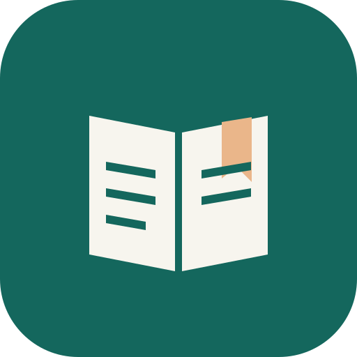
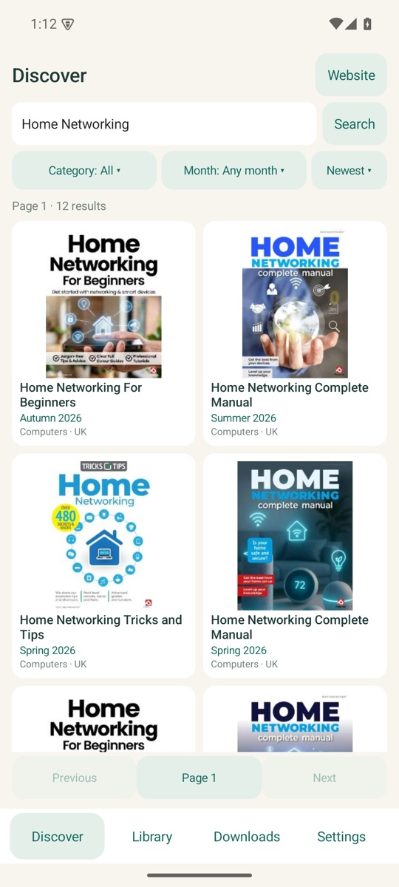
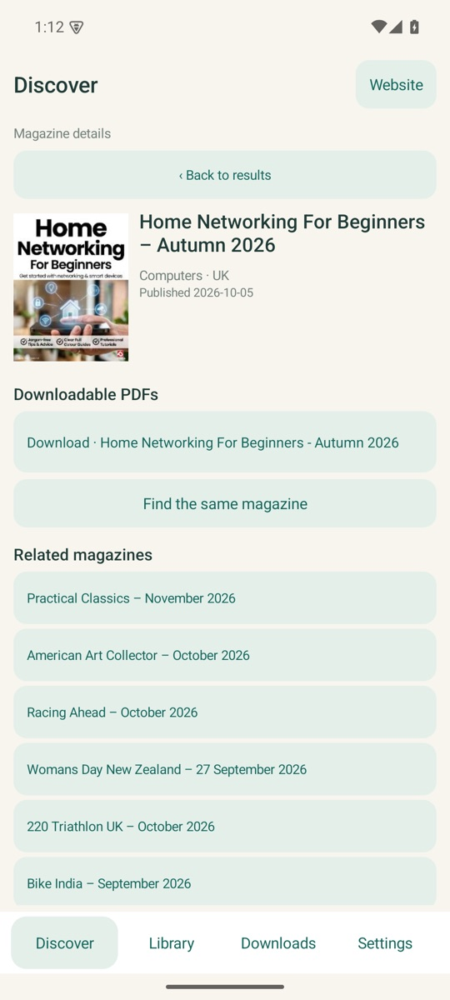
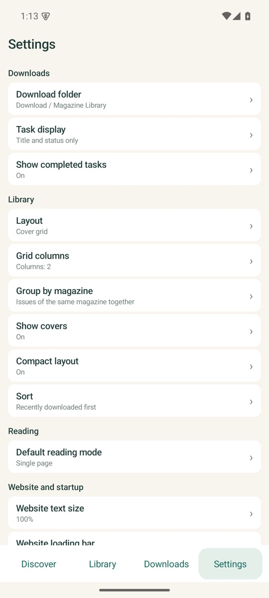
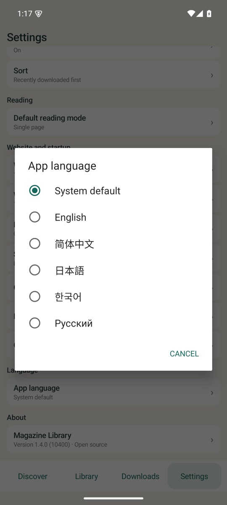

<div align="center">


# Magazine Library

잡지는 PDF로 옵니다. 휴대폰에서 그 잡지를 오프라인으로 읽을 수 있어야 합니다.

[](https://github.com/kongdayan/magazine-library-android/actions/workflows/ci.yml)
[](https://github.com/kongdayan/magazine-library-android/releases/latest)
[](LICENSE)
[](https://github.com/kongdayan/magazine-library-android/releases/latest)
[](docs/ARCHITECTURE.md#localization)

[English](README.md) · [简体中文](README.cn.md) · [日本語](README.ja.md) · [한국어](README.ko.md) · [Русский](README.ru.md)

</div>

**잡지 사이트를 둘러보고 PDF를 내려받아 오프라인에서 읽는 작고 가벼운 Android 클라이언트입니다.**

기차에서 한 호만 읽으려고 브라우저 탭과 다운로드 폴더, 그리고 별도의 PDF 뷰어를 오가고 싶지 않았습니다. Magazine Library는 사이트 세션을 WebView에 유지하고, 사용자가 요청한 페이지를 네이티브 컨트롤로 바꾸며, 백그라운드에서 내려받은 파일을 읽던 위치를 기억하는 리더로 열어 줍니다. 계정도, 광고도, 분석 도구도, 클라우드도 없습니다.

- **웹의 잡동사니 없이 탐색합니다.** 검색, 카테고리, 발행 월, 표지, 상세 정보, 같은 잡지 찾기, 페이지별 정렬과 페이지 이동까지 모두 네이티브 뷰로 표시합니다. 요청되는 페이지는 사용자가 연 페이지 하나뿐입니다.
- **사이트에 막히지 않는 다운로드.** 다운로더는 호스트별로 브라우저 세션을 유지하고, 사이트의 파일 준비 단계를 따르며, 서버가 허용할 때 이어받기로 재개하고, PDF를 검증한 뒤에야 Downloads 폴더나 사용자가 선택한 폴더에 저장합니다.
- **폴더가 아니라 보관함입니다.** 표지, 그리드 또는 목록, 잡지별 묶기, 이름 변경, 정렬, 읽기 진행률을 제공합니다. 파일은 사용자가 둔 위치에 그대로 남습니다.
- **제대로 읽습니다.** 한 페이지씩 넘기거나 연속해서 스크롤하기, 두 손가락 확대, 페이지 이동, 그리고 다시 실행해도 유지되는 읽기 위치를 제공합니다.
- **다섯 개 언어, 하나의 작은 APK.** 영어, 중국어 간체, 일본어, 한국어, 러시아어를 지원하며 설정이나 Android의 앱별 언어에서 바꿀 수 있습니다. AndroidX도, 런타임 라이브러리도, 광고도 없습니다.

<div align="center">
  
  
  
  <br />
  
</div>

화면은 지원하는 다섯 개 언어 중 하나인 중국어 간체로 표시되어 있습니다. 1.3 검증 실행 중 실제 기기에서 촬영했으며, 자세한 내용은 [검증 범위](docs/VERIFICATION.md)를 참고하세요.

## 설치

Android 10 (API 29) 이상이 필요합니다.

| 기기 | 다운로드 |
| --- | --- |
| 지원되는 모든 기기 (**권장**) | [MagazineLibrary-universal.apk](https://github.com/kongdayan/magazine-library-android/releases/latest/download/MagazineLibrary-universal.apk) |
| arm64-v8a | [MagazineLibrary-arm64-v8a.apk](https://github.com/kongdayan/magazine-library-android/releases/latest/download/MagazineLibrary-arm64-v8a.apk) |
| armeabi-v7a | [MagazineLibrary-armeabi-v7a.apk](https://github.com/kongdayan/magazine-library-android/releases/latest/download/MagazineLibrary-armeabi-v7a.apk) |
| x86_64 (에뮬레이터) | [MagazineLibrary-x86_64.apk](https://github.com/kongdayan/magazine-library-android/releases/latest/download/MagazineLibrary-x86_64.apk) |

앱에 네이티브 라이브러리가 포함되어 있지 않으므로 모든 APK가 지원되는 모든 기기에서 실행됩니다. 따라서 유니버설 빌드가 가장 간단한 선택입니다. 릴리스는 공개 [커뮤니티 키](signing/keystore.properties)로 서명되므로 이전에 사이드로드로 설치한 버전 위에 그대로 업그레이드할 수 있습니다. 내려받은 파일은 릴리스 페이지의 `SHA256SUMS`로 확인하세요. Google Play로는 배포하지 않습니다.

## 사용 방법

1. **탐색**을 열고 검색하거나 카테고리와 월을 선택한 다음 잡지를 엽니다.
2. PDF 항목을 누릅니다. 사이트에서 파일을 준비하는 데 잠시 시간이 걸릴 수 있으며, 다운로드는 백그라운드에서 계속되어 **다운로드**에 나타납니다.
3. 완료된 파일은 `Downloads/Magazine Library` 또는 사용자가 선택한 폴더에 저장되고, 해당 호는 **보관함**에 나타납니다.
4. 표지를 눌러 읽습니다. 한 페이지 모드에서는 가로로 밀고, 연속 모드에서는 스크롤하며, 페이지 번호를 눌러 이동합니다. 마지막으로 읽은 페이지가 기억됩니다.

사이트 확인 페이지가 나타나면 앱의 **웹사이트** 보기에서 직접 완료하세요. 이는 의도적으로 남겨 둔 수동 단계입니다. 사이트가 마크업을 바꾸면 네이티브 추출기가 업데이트될 때까지 웹사이트 보기를 대체 수단으로 계속 사용할 수 있습니다.

## 동작 방식

시스템 WebView가 브라우저 세션 역할을 합니다. 사용자가 요청한 페이지의 로드가 끝나면 읽기 전용 스크립트가 현재 잡지 응답을 JSON으로 추출하고, 네이티브 뷰가 이를 렌더링합니다. 사이트를 크롤링하거나 미리 가져오지 않습니다. 표지도 같은 세션을 사용합니다. 다운로더는 정확한 URL에 대한 쿠키를 읽고, 리디렉션을 직접 처리하며, 가능하면 `Range`로 이어받기를 하고, `%PDF-` 및 `PdfRenderer` 검증을 통과한 뒤에야 파일을 공개합니다.

자세한 내용: [아키텍처](docs/ARCHITECTURE.md) · [개인정보](PRIVACY.md) · [보안 정책](SECURITY.md).

## 빌드

요구 사항: JDK 17, Android SDK 플랫폼 36, Build Tools 35.0.0. Gradle 8.11.1은 래퍼에서 제공됩니다.

```sh
./gradlew :app:assembleRelease
./gradlew :app:testDebugUnitTest :app:lintDebug
python3 scripts/check-translations.py
```

릴리스 빌드는 커뮤니티 키로 서명되므로 사이드로드 설치가 계속 업그레이드됩니다. 자체 키를 사용하려면 `SIGNING_*` 환경 변수를 설정하세요. [빌드 노트](docs/BUILDING.md) · [릴리스 절차](docs/RELEASING.md).

## 언어

| 언어 | 앱 UI | README |
| --- | --- | --- |
| 영어 (기본) | `values/` | 이 파일 |
| 简体中文 | `values-zh-rCN/` | [README.cn.md](README.cn.md) |
| 日本語 | `values-ja/` | [README.ja.md](README.ja.md) |
| 한국어 | `values-ko/` | [README.ko.md](README.ko.md) |
| Русский | `values-ru/` | [README.ru.md](README.ru.md) |

번역은 CI에서 검사합니다. 키, 자리 표시자, 번역하지 않는 문자열이 영어 원본과 일치해야 합니다. 새로운 언어도 환영합니다. [기여 가이드](CONTRIBUTING.md#translation-rules)를 참고하세요.

## 프로젝트

- [변경 로그](CHANGELOG.md)
- [아키텍처](docs/ARCHITECTURE.md)
- [빌드](docs/BUILDING.md) · [릴리스](docs/RELEASING.md)
- [검증 범위](docs/VERIFICATION.md) · [기기 검증 기록](docs/verification/)
- [개인정보](PRIVACY.md) · [보안](SECURITY.md) · [기여](CONTRIBUTING.md)

## 작성자

**kongdayan** — 독립 개발자입니다.

프라이버시를 존중하고 오프라인에서도 동작하는 작은 도구를 만듭니다. Magazine Library도 그중 하나이며, [WristBeam](https://github.com/kongdayan/wristbeam)(腕映)은 Garmin 워치를 위한 네이티브 macOS 컴패니언 앱입니다.

[GitHub](https://github.com/kongdayan) · [이슈](https://github.com/kongdayan/magazine-library-android/issues)

## 고지

Magazine Library는 `magazinelib.com`의 독립적인 비공식 클라이언트이며 그 사이트와 제휴 관계가 없습니다. 이 앱은 브라우저이자 다운로드 관리자일 뿐이며 콘텐츠를 호스팅하거나 색인하지 않습니다. 다운로드는 원본 사이트의 약관과 저작권법의 적용을 받으므로 합법적으로 접근할 수 있는 자료에만 사용해야 합니다. 저자는 제3자 콘텐츠가 사용되는 방식에 대해 책임지지 않습니다.

## 라이선스

[MIT](LICENSE) © 2026 kongdayan and contributors.
